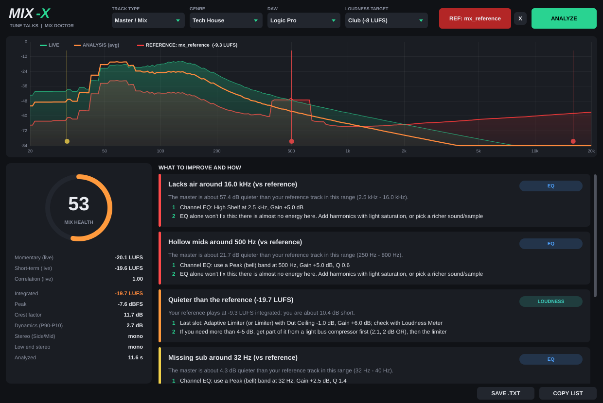

# Mix-X by Tune Talks: a mix doctor for Logic Pro and Ableton Live (AU / VST3)

Mix-X listens to a track, a bus or your master and gives you a **step-by-step list of fixes** for EQ,
compression, sidechain, saturation, stereo and loudness. Every fix comes with **exact values** (frequency, gain,
Q, threshold, ratio, attack, release, drive…) and names the **stock plug-ins of your DAW**:
Channel EQ, Compressor, ChromaGlow, Direction Mixer and Adaptive Limiter in Logic; EQ Eight, Compressor,
Glue Compressor, Saturator, Utility and Limiter in Ableton.

Audio passes through **untouched**: Mix-X analyzes and advises, and you make the moves.

## How to use it
1. Insert Mix-X **at the end of the chain** on a track, bus or the master.
2. Pick **TRACK TYPE** (Master, Drum Bus, Kick, Bass, Vocal, Lead/Synth, Pad, Hats/Perc), **GENRE**, **DAW** and **LOUDNESS TARGET**.
3. Press **ANALYZE** and play the most representative section for 10-30 s. It stops on its own at 30 s.
4. Read **WHAT TO IMPROVE AND HOW**, sorted by severity. You can copy it (**COPY LIST**) or save it (**SAVE .TXT**).
5. Apply the changes and analyze again to watch the score go up.

You can change track type, DAW or genre after the analysis: the advice updates without measuring again.

### Reference track
Click **LOAD REFERENCE** and pick a finished track you'd like to sound like (WAV, AIFF, FLAC, MP3, M4A).
Mix-X analyzes the whole file. Its spectrum then shows up **in red behind your mix**, level-matched so you compare
tonal balance rather than volume. From then on the advice is relative to the reference:
EQ ("−3 dB at 400 Hz vs reference"), loudness (the reference's LUFS become your target), density (peak-to-loudness ratio)
and stereo width. **X** removes the reference and brings back the generic genre target. The reference is saved with your project.

### Sidechain against the kick
For bass, pads, synths and vocals, route the **Kick** into Mix-X's side-chain input:
- **Logic:** use the *Side Chain* menu at the top right of the plug-in window and choose the Kick track.
- **Ableton:** if your Live version supports it, pick the Kick track in the plug-in's sidechain settings.

Mix-X measures how much the kick and the track overlap below 150 Hz and how much ducking is already there.
It then gives you the sidechain compressor depth and release, based on the project tempo.

## What it measures
- **Spectrum:** 1/3-octave balance against a reference for the track type and genre (mud, boxiness, nasal mids,
  harshness, sibilance, air, sub), plus narrow resonances, rumble and sub-sonic energy.
- **Dynamics:** crest factor, dynamic range (P90-P10), over- and under-compression.
- **Loudness:** integrated, momentary and short-term LUFS (ITU-R BS.1770), peaks, peak-to-loudness ratio, club or streaming target.
- **Saturation:** digital clipping, bass without harmonics, kick without click, harsh distortion, thin/clean sounds.
- **Stereo:** correlation and mono compatibility, stereo low end, width, DC offset.
- **Sidechain:** kick hits, low-end masking, existing ducking.

The **MIX HEALTH** score (0-100) sums it all up.

## Install
Download `MixX-x.y.z-macOS.pkg` from [Releases](https://github.com/andreagrasselliatcg-art/mix-x/releases/latest),
then right-click → Open.
- **Logic:** Audio FX → Audio Units → Tune Talks → Mix-X.
- **Ableton:** Plug-ins → Tune Talks → Mix-X.

## Training
The diagnosis thresholds were tuned on ~420 labelled mixes with known injected defects plus 10 real recordings:
**99% of injected problems detected, 0.06 false alarms per clean mix** (see [TRAINING.md](TRAINING.md)).

## Honest notes
The spectral references are average curves, not rules. If a choice is intentional (a dark pad, say), ignore the advice.
Your ears always have the final word. Logic and Ableton don't let one plug-in change another plug-in's settings,
which is why Mix-X tells you what to do instead of doing it.

## Development
Run `cmake -B build -DMX_BUILD_TESTS=ON && cmake --build build --target MixXTests`. The tests feed in mixes with known
problems and check that each one is diagnosed: mud, rumble, dynamics, clipping, over-limiting, bass without harmonics,
stereo bass, kick/bass masking, existing ducking, plus LUFS calibration.
